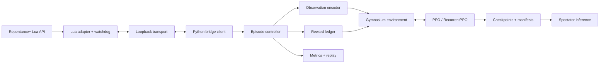

# Architecture and component boundaries

## Current module map (pure profile, 2026-10-22)

The project was refactored for pure self-learning (`pure-self-learning-v1`).
Hint, diagnostic, native-episode and roadmap modules are in `archive/`. Sections
below this one are the original design record; where they mention removed
features (combat gate, geometry, firing diagnostics, spectator, native step
protocol), `archive/` holds that code.

| Module | Responsibility |
| --- | --- |
| `mod/observer/main.lua` | Lua adapter: schema 4 snapshots, oracle block, actions with use head, restart command, death restart, watchdogs |
| `observation.py`, `entities.py`, `live_wire.py` | Strict wire models (handshake, snapshot, entity frame, oracle, acks) |
| `observer_client.py` | Loopback listener, negotiation, ordering |
| `live.py` | Live client, event deriver, live backend, fault-tolerant env, approvals, train/random runs |
| `stall_watchdog.py` | Stall detection that truncates and requests a restart |
| `episodes.py`, `env.py` | Episode controller and Gymnasium env (`MultiDiscrete([5,5,4])`, 2038 floats) |
| `encoding.py` | Observation schema 4 encoder |
| `rewards.py` | Reward v1 (offline sim) and reward v4 ledger |
| `episode_metrics.py` | Per-episode CSV rows |
| `training.py`, `checkpoints.py` | Continuous RecurrentPPO training, lineage, retention, use-head prior at model creation |
| `session_runner.py` | Windows supervisor, single session or forever |
| `launcher.py`, `menu_entry.py`, `windows_menu.py` | Steam launch and guarded file-2 menu entry |
| `checkpoint_policy.py`, `live_evaluation.py`, `evaluation.py`, `baselines.py` | Frozen and offline evaluation |
| `sim.py`, `scenarios.py`, `recording.py`, `native_events.py` | Synthetic backend, offline scenarios, recording and replay |

## Decision status

This is the target architecture. Bootstrap, diagnostics, stack smoke and a minimal
read-only Lua/Python observer are implemented locally. The current wire contract
is in [OBSERVATION_PROTOCOL](OBSERVATION_PROTOCOL.md); its bounded read-only
acceptance passed with offline and authorized real-game evidence.
Bounded native actions are accepted (item 03), with default authority disabled.
Observer 0.4.0 also implements the accepted read-only entity export (item 04),
fixed-shape encoding and recorded real fixtures. See SAFE_ACTIONS.md and
ENTITY_OBSERVATION_PROTOCOL.md. These modes cannot currently combine.
Episode control, native reward events, synchronized step/reset and training
remain future integration work; the corresponding Python modules are offline
contracts over synthetic backends.

The original LuaSocket adapter runs on J460 without REPENTOGON. Special weapons,
complete geometry/faction semantics and long-run training are not implied by
these bounded accepted slices.

## Components

The user entry point is Start-Isaac.cmd calling the project Python launcher. It
binds the read-only bridge before requesting game launch and writes bounded
session logs while displaying terminal progress. Normal operation does not use
screen capture, screen coordinates or synthetic desktop inputs. Future mode
selection, slot-2 attestation, achievement eligibility and Dead God progression
are described in PROGRESSION_GOAL.md; the current launcher does not implement them.

| Component | Responsibility | Excluded responsibility |
|---|---|---|
| Lua adapter | API snapshots/events, action application, neutral/watchdog | Learning or indefinitely waiting for Python |
| Transport | Framing, bounded messages, timeouts, handshake | Rewards or neural-network architecture |
| Bridge client | Version validation, session/frame consistency | Unbounded retries or accepting stale frames |
| Episode controller | Start/reset/end, identity, lifecycle, faults | Treating network failure as character death |
| Observation encoder | Visible features, masks, normalization | Hidden maps and oracle labels |
| Reward ledger | Once-only events, cumulative caps, components | Predefined action strategy |
| Gym environment | reset/step/close and step contract | Installing Steam or changing user profiles |
| Trainer | Budgets, seeds, checkpoint/evaluation callbacks | Silently disabling failing checks |
| Evaluator | Frozen policy and metrics on a specified split | Tuning against test results |
| Spectator | Checkpoint selection, ordinary speed, stopping | Hidden training |

Create packages such as `bridge/`, `env/`, `observations/`, `rewards/`, `training/`,
`evaluation/`, and `knowledge/` as needed. Actual game-mod code belongs in `mod/`.

## Proposed transport contract v1

The audit determines serialization. An initial JSON protocol needs length-prefix
or bounded newline framing, UTF-8, and schema validation. One socket read does not
necessarily contain exactly one message.

Handshake: `protocol_version`, `game_build`, `mod_build`, `capabilities`, `session_id`.
Snapshot: `session_id`, `episode_id`, `frame_id`, `room_id`, schema version,
player/entity data, and permitted events. Command: session/episode, sequence ID,
expected frame or validity interval, action, and expiry. Acknowledgments identify
the applied frame; lack of acknowledgment cannot be assumed successful.

Entity IDs can repeat across episodes. Ledger keys include episode identity and
spawn generation. Reconnection must explicitly establish continuity or a new
session; previously rewarded events cannot be rewarded again.

Initial limits to validate in a change: 1 MiB maximum message, two-second step
timeout, and 0.5-second watchdog. These are **design hypotheses**, not a promise of
supported game frequency. Reconcile them with callbacks and pause behavior.
Resuming a paused game must not continue previously held input unexpectedly.

Bind only to `127.0.0.1`; do not open an inbound firewall rule. No `eval`, arbitrary
Lua execution, or shell-command execution through the game protocol.

## Step semantics

1. Receive current state N and validate identity and monotonicity.
2. Send a valid action with a sequence ID and bounded repeat.
3. Confirm application and obtain state N+k.
4. Collect interval events exactly once.
5. Build observation, reward, terminated/truncated, and diagnostic info.

Measure `k` in game updates, not rendering FPS. Define pause, menus, and room
transitions explicitly. A transport fault is not inserted as a valid MDP
transition; evaluator recovery/exclusion behavior must be documented.

`reset(seed)` either controls the game seed or explicitly reports that the feature
is unsupported. A NumPy seed does not make the game deterministic. `close()` is
idempotent and releases control, including on error paths.

## Separate data channels

The policy receives player-permitted information: current visible room/objects,
remembered known map, inventory, and reference item features. A training oracle
may carry hidden targets/labels only for reward and evaluation. Separate channels
by types/schemas, not merely a `hidden=true` flag in a shared dictionary.

Prevent indirect leakage through seed-based map memorization, ordering by hidden
room IDs, normalization over oracle fields, and auxiliary training on test labels.
An intentional privileged critic requires a separate design and experiment; actor
inference must still exclude hidden information.

## Run artifacts

`runs/<run-id>/` contains a manifest, resolved configuration, events.jsonl, metrics,
checkpoints, and evaluation summary. Commit a short reproducible report, not large
artifacts. Small committed fixtures must be permitted and free of personal data.
Version the manifest format independently.

Persist the last completed record atomically on failure. Do not promise exact
mid-episode resume without an engine snapshot; restart the episode and record the
discontinuity when necessary. Write all artifact metadata and reports in English.

## Optional post-death lifecycle

Adapter 0.2.0 keeps observation as the default, with a separately negotiated
`death_restart_v1` capability. The fixed local death-restart state machine is
bound to connection session, run epoch, lease and attempt count. It exposes no
post-hello commands or player inputs. See DEATH_RESTART.md. Bounded real-game acceptance
passed on J460 for one natural character-0 game over and fresh run; initial
application launch and save selection remain manual.

## Native action slice (active, not accepted)

Source adapter 0.3.0 optionally negotiates safe_actions_v1 after local evidence
approval. It uses native MC_INPUT_ACTION for independent cardinal movement and
shooting, bounded neutral/release, session/epoch/room/frame identity, 250 ms and
15-frame maximum expiry and 500 ms heartbeat. Python ActionClient is attach-only
and synchronous; no background policy or auto-replay exists. Actions and death
restart are mutually exclusive. The default remains observation. Exact semantics,
blocked prerequisites and required 50-sequence evidence are in SAFE_ACTIONS.md.

## Ordinary-profile action authorization amendment

Adapter 0.3.1 implements the user's explicit ordinary-profile exception for
bounded movement/shooting tests, a private expiring approval read during hello,
120-second per-mod-load authority, native tear/release evidence and an attach-only
finite probe. Default observation remains read-only. Standing permission is
recorded; current operator-confirmed slot/process evidence is still required.
No training or automated slot attestation is implied. See SAFE_ACTIONS.md.
